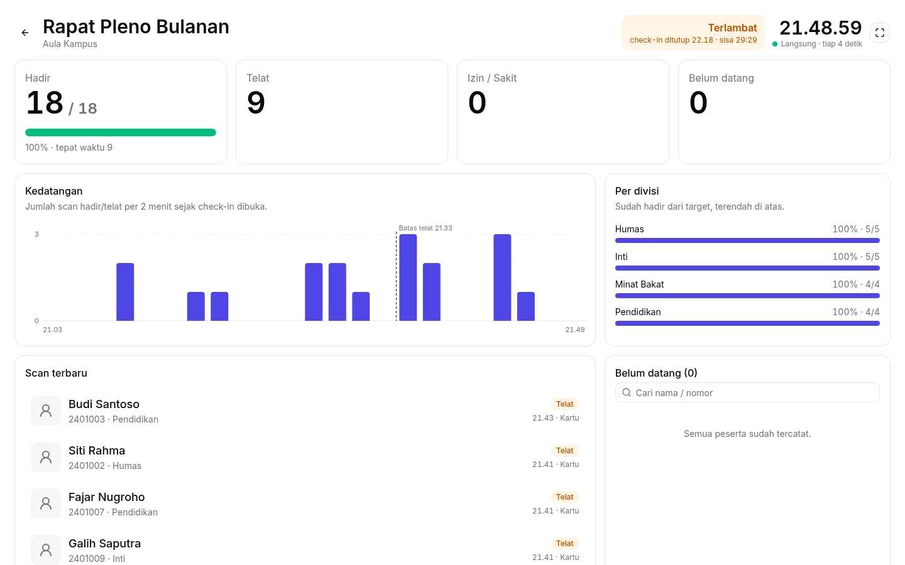
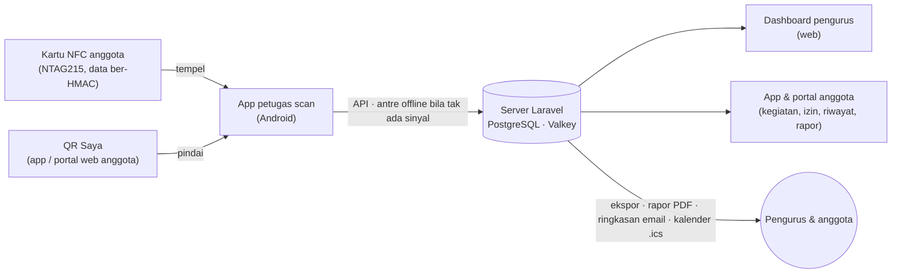
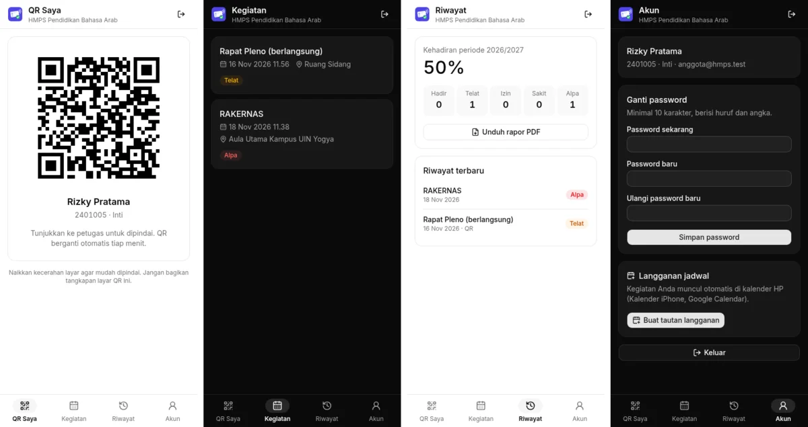

<p align="center">
  
</p>

<h1 align="center">Kartu Anggota NFC</h1>

<p align="center">
  Absensi kegiatan organisasi dengan kartu anggota NFC: petugas cukup menempelkan kartu ke HP,
  pengurus memantau dan merekap dari dashboard web, anggota melihat kehadirannya sendiri.
</p>

<p align="center">
  <a href="LICENSE"></a>
  <a href="https://github.com/ranupaners-arch/kartu-anggota-nfc/actions/workflows/backend.yml"></a>
  <a href="https://github.com/ranupaners-arch/kartu-anggota-nfc/actions/workflows/app.yml"></a>
  <a href="https://github.com/ranupaners-arch/kartu-anggota-nfc/actions/workflows/image.yml"></a>
</p>

<p align="center">
  
</p>

## Daftar isi

- [Cara kerja](#cara-kerja)
- [Fitur](#fitur)
- [Isi repo](#isi-repo)
- [Menjalankan untuk pengembangan](#menjalankan-untuk-pengembangan)
- [Produksi](#produksi)
- [Keamanan & privasi](#keamanan--privasi)
- [Kontribusi](#kontribusi)
- [Lisensi & hak cipta](#lisensi--hak-cipta)

## Cara kerja



1. Pengurus membuat kegiatan (jendela check-in, target peserta, sesi) di **dashboard**.
2. Petugas membuka kegiatan di **app**, lalu anggota menempelkan **kartu NFC** — atau menunjukkan **QR Saya** bila kartu tertinggal. Status Hadir/Telat dihitung dari jam scan.
3. Saat kegiatan ditutup, yang tidak hadir otomatis **Alpa** — atau **Izin/Sakit** bila izinnya disetujui.
4. Pengurus memantau langsung, meninjau anomali, merekap & mengekspor; anggota melihat riwayat dan rapornya sendiri.

## Fitur

**Absensi**
- Kartu **NFC (NTAG215)** berisi data bertanda tangan (HMAC) — kartu palsu ditolak; **QR dinamis** (berganti tiap menit) sebagai cadangan.
- Jendela check-in (tepat waktu → telat → tutup), kegiatan **multi-sesi**, target per divisi/anggota.
- **Mode offline** di app petugas: scan diantre di HP dan disinkronkan saat online; konflik ditandai untuk ditinjau.
- Kegiatan ditutup otomatis oleh scheduler.

**Dashboard pengurus**
- **Monitor langsung** untuk proyektor (diperbarui tiap 4 detik, grafik kedatangan & per divisi).
- **Kalender** kegiatan dengan warna per divisi dan tanda **bentrok jadwal**; duplikat & kegiatan berulang.
- Pengajuan izin, peninjauan anomali, **tindakan massal**, pengumuman.
- Statistik & peringatan **anggota yang perlu perhatian**, perbandingan antarperiode.
- Rekap & ekspor Excel/PDF, **rapor kehadiran PDF**, pencarian cepat (**Ctrl+K**), log aktivitas.
- **Akun app anggota massal** dengan lembar akun siap cetak (QR penghubung + password sementara yang wajib diganti).
- Peran **Super Admin / Admin Divisi / Petugas Scan / Anggota**, **2FA**, mode terang/gelap, nyaman di HP.
- Email (opsional, aktif setelah SMTP diatur): **lupa password** mandiri & **ringkasan mingguan** pengurus.

**Untuk anggota — app Android atau portal web (iPhone)**
- QR Saya, kegiatan & pengingat, pengumuman, **ajukan izin** dengan bukti, riwayat & peringatan, **rapor PDF**, **langganan jadwal** ke Google Calendar / kalender HP.
- **Portal web** `/saya` untuk yang tidak memakai app Android, bisa dipasang di Layar Utama.

<p align="center">
  
</p>
<p align="center">
  
  
</p>

## Isi repo

| Folder | Isi |
|---|---|
| [`backend/`](backend) | Laravel 13 (PHP 8.3+): API untuk app, dashboard & portal anggota (Inertia + React + shadcn/ui), PostgreSQL, Valkey/Redis |
| [`app/`](app) | App Android (Flutter): mode **petugas scan** (NFC/QR, offline) dan mode **anggota** |
| [`deploy/`](deploy) | Stack Docker produksi: PHP-FPM, Caddy (HTTPS otomatis), PostgreSQL, Valkey, queue, scheduler, backup harian |
| [`docs/`](docs) | [PRD](docs/PRD.md) · [panduan pengguna](docs/panduan/README.md) (pengurus, petugas, anggota, checklist hari-H) · [deploy](docs/deploy.md) · [catatan uji](docs/catatan-uji.md) · [brand](docs/brand) |

## Menjalankan untuk pengembangan

Kebutuhan: PHP 8.3+, Composer, Node.js, PostgreSQL, Valkey/Redis; Flutter (untuk app).

```bash
# Backend + dashboard
cd backend
cp .env.example .env            # DB_CONNECTION=pgsql + DB_* (kueri memakai fitur PostgreSQL), REDIS_*
composer install && npm install
php artisan key:generate
php artisan migrate --seed      # data contoh (lihat akun di bawah)
npm run build                   # atau: npm run dev
php artisan serve               # http://127.0.0.1:8000/masuk

# Tes
php artisan test

# App Android
cd ../app
flutter pub get
flutter test
flutter run                     # perlu HP Android dengan NFC untuk mode scan
```

Akun dari data contoh (password = `SEED_PASSWORD`, bawaan `password`):

| Email | Peran | Masuk ke |
|---|---|---|
| `superadmin@hmps.test` | Super Admin | Dashboard |
| `humas@hmps.test` | Admin Divisi (Humas) | Dashboard |
| `petugas@hmps.test` | Petugas Scan | App |
| `anggota@hmps.test` | Anggota | App atau portal `/saya` |

Di app, hubungkan ke server dengan memindai QR di **Pengaturan → Aplikasi** pada dashboard (atau ketik alamat server).

## Produksi

Satu VPS dengan Docker Compose — lihat [docs/deploy.md](docs/deploy.md): HTTPS otomatis, backup harian + uji
pemulihan, pemantauan (`/api/health`, Sentry opsional), dan pengaturan email.

CI ([`.github/workflows`](.github/workflows)):
- **Backend (Laravel)** dan **App (Flutter)** — tes di setiap pull request.
- **Deploy (uji stack Docker)** — membangun stack produksi lalu menguji login, antrean, scheduler, uji beban scan, dan backup/restore; di setiap merge ke `main` (sebelum image diterbitkan) dan tiap minggu.
- APK uji dibuat manual (`gh workflow run app.yml`).

## Keamanan & privasi

- Data kartu ditandatangani HMAC; kunci rahasia hanya di server. QR anggota berumur pendek dan dirotasi.
- 2FA (TOTP) untuk pengurus; password sementara wajib diganti; perangkat petugas bisa dicabut aksesnya.
- Semua data dibatasi per organisasi dan per divisi (Admin Divisi); log aktivitas untuk tindakan penting.
- Persetujuan pemrosesan data anggota, hapus data pribadi, dan retensi otomatis (bukti izin, data lama, ekspor).

Menemukan celah keamanan? Jangan buka issue publik — ikuti [SECURITY.md](SECURITY.md).

## Kontribusi

- Kerja di branch (`feat/…`, `fix/…`, `docs/…`), lalu pull request ke `main`; merge setelah CI hijau.
- Commit kecil dan atomik, pesan [Conventional Commits](https://www.conventionalcommits.org/) berbahasa Indonesia (mis. `fix(app): …`, `feat(dashboard): …`).
- Panduan lengkap ada di [CONTRIBUTING.md](CONTRIBUTING.md).
- Sertakan tes untuk perubahan perilaku: `php artisan test` (backend) dan `flutter test` (app).
- Dengan mengirim kontribusi, Anda setuju kontribusi itu dirilis di bawah lisensi yang sama (GPL-3.0-or-later).

## Lisensi & hak cipta

Hak cipta © 2026 **Ranupane Rimba**.

Kartu Anggota NFC adalah perangkat lunak bebas: Anda boleh menyebarluaskan dan/atau mengubahnya di bawah
ketentuan **GNU General Public License** versi 3 atau (sesuai pilihan Anda) versi yang lebih baru, sebagaimana
diterbitkan oleh Free Software Foundation. Program ini dibagikan dengan harapan bermanfaat, tetapi **tanpa
jaminan apa pun**. Teks lengkap ada di [LICENSE](LICENSE).

Singkatnya: siapa pun yang menyalin, mengubah, atau menyebarkan versi turunannya wajib **mempertahankan
pemberitahuan hak cipta ini**, mencantumkan perubahan yang dibuat, dan merilis versi turunannya dengan
**kode sumber terbuka di bawah GPL** juga.
