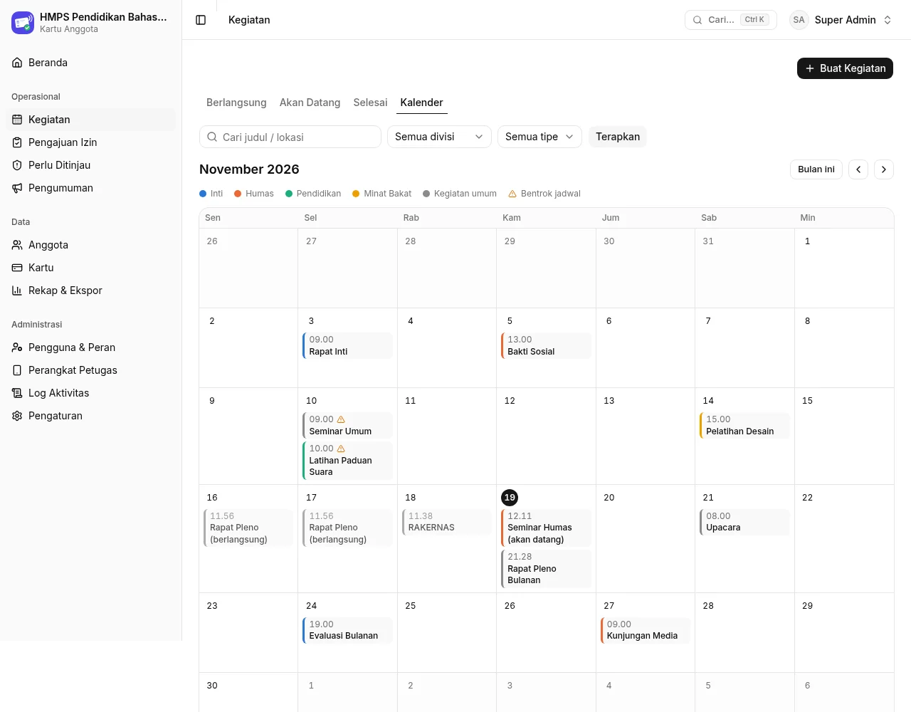
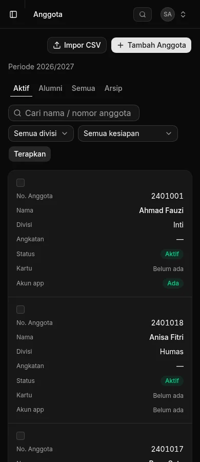

<p align="center">
  
</p>

<h1 align="center">Kartu Anggota NFC</h1>

<p align="center">
  Absensi kegiatan organisasi dengan kartu anggota NFC: petugas cukup menempelkan kartu ke HP,
  pengurus memantau dan merekap dari dashboard web.
</p>

<p align="center">
  
</p>

## Isi repo

| Folder | Isi |
|---|---|
| [`backend/`](backend) | Laravel 13 (PHP 8.3+): API untuk app, dashboard web (Inertia + React + shadcn/ui), PostgreSQL, Redis/Valkey |
| [`app/`](app) | App Android (Flutter): mode **petugas scan** (NFC/QR) dan mode **anggota** |
| [`deploy/`](deploy) | Stack Docker produksi: PHP-FPM, Caddy (HTTPS otomatis), PostgreSQL, Valkey, queue, scheduler, backup harian |
| [`docs/`](docs) | [PRD](docs/PRD.md), [panduan pengguna](docs/panduan/README.md), [panduan deploy](docs/deploy.md), [catatan uji](docs/catatan-uji.md) |

## Fitur utama

**Absensi**
- Scan kartu **NFC (NTAG215)** berisi data bertanda tangan (HMAC) — kartu palsu ditolak; **QR dinamis** di app anggota sebagai cadangan bila kartu tertinggal.
- Jendela check-in (tepat waktu → telat → tutup), kegiatan **multi-sesi**, target per divisi/anggota, **mode offline** (antre di HP, sinkron saat online, konflik ditandai untuk ditinjau).
- Kegiatan ditutup otomatis: yang tidak hadir menjadi Alpa, atau Izin/Sakit bila izinnya disetujui.

**Dashboard pengurus**
- **Monitor langsung** untuk proyektor (diperbarui tiap 4 detik), **kalender** kegiatan dengan tanda bentrok jadwal, duplikat/kegiatan berulang.
- Pengajuan izin, peninjauan anomali, **tindakan massal**, pengumuman, statistik & peringatan anggota yang perlu perhatian, perbandingan antarperiode.
- Rekap & ekspor Excel/PDF, **rapor kehadiran PDF** per anggota, pencarian cepat (**Ctrl+K**), log aktivitas.
- **Akun app anggota massal** dengan lembar akun siap cetak (QR penghubung + password sementara yang wajib diganti).
- Peran Super Admin / Admin Divisi / Petugas / Anggota, **2FA**, mode terang/gelap, nyaman di HP.

**App anggota**
- QR Saya, daftar kegiatan & pengingat, ajukan izin dengan bukti, riwayat & peringatan, rapor PDF, **langganan jadwal** (Google Calendar / kalender HP).

<p align="center">
  
  
</p>

## Menjalankan untuk pengembangan

Kebutuhan: PHP 8.3+, Composer, Node.js, PostgreSQL, Redis/Valkey; Flutter (untuk app).

```bash
# Backend + dashboard
cd backend
cp .env.example .env            # DB_CONNECTION=pgsql + DB_* (kueri memakai fitur PostgreSQL), REDIS_*
composer install && npm install
php artisan key:generate
php artisan migrate --seed      # data contoh; password semua akun = SEED_PASSWORD (bawaan: password)
npm run build                   # atau: npm run dev
php artisan serve               # http://127.0.0.1:8000/masuk

# Tes
php artisan test

# App Android
cd ../app
flutter pub get
flutter test
flutter run                     # perlu HP Android dengan NFC untuk mode scan
```

Di app, hubungkan ke server dengan memindai QR di **Pengaturan → Aplikasi** pada dashboard (atau ketik alamat server).

## Produksi

Satu VPS dengan Docker Compose — lihat [docs/deploy.md](docs/deploy.md): HTTPS otomatis, backup harian + uji pemulihan,
pemantauan (`/api/health`, Sentry opsional), dan pengaturan email (lupa password & ringkasan mingguan pengurus).

## CI

- **Backend (Laravel)** dan **App (Flutter)**: tes di setiap pull request.
- **Deploy (uji stack Docker)**: membangun stack produksi lalu menguji login, antrean, scheduler, uji beban scan, dan backup/restore — di setiap merge ke `main` dan tiap minggu.
- APK uji dibuat manual (`gh workflow run app.yml`).

## Lisensi

Belum ditentukan. Sampai ada berkas `LICENSE`, hak cipta tetap pada pemilik repo.
